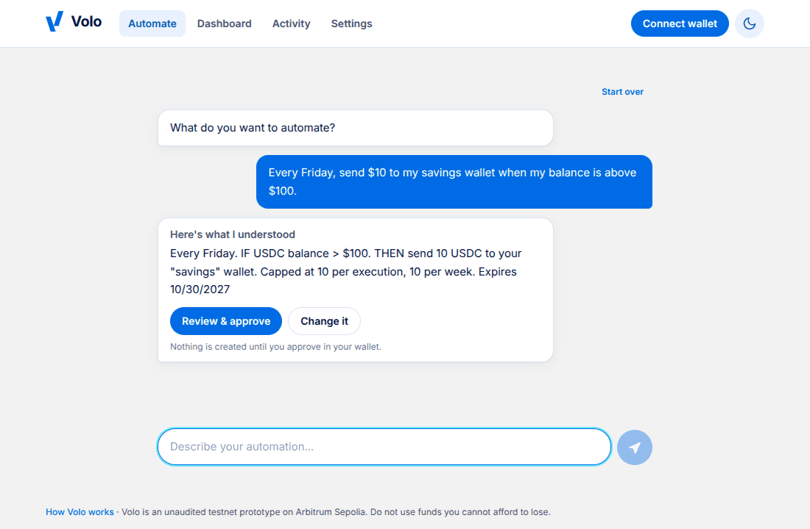
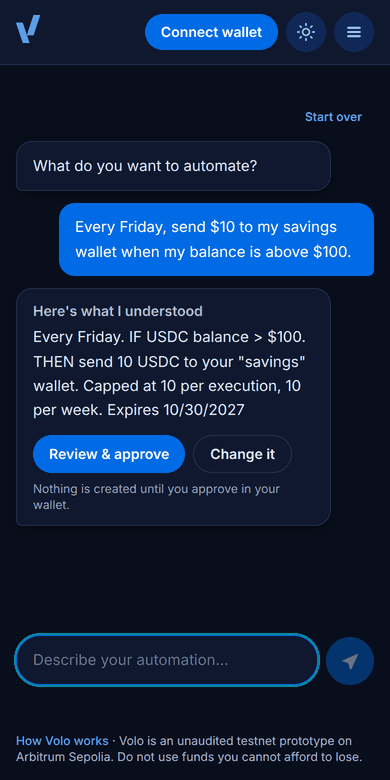
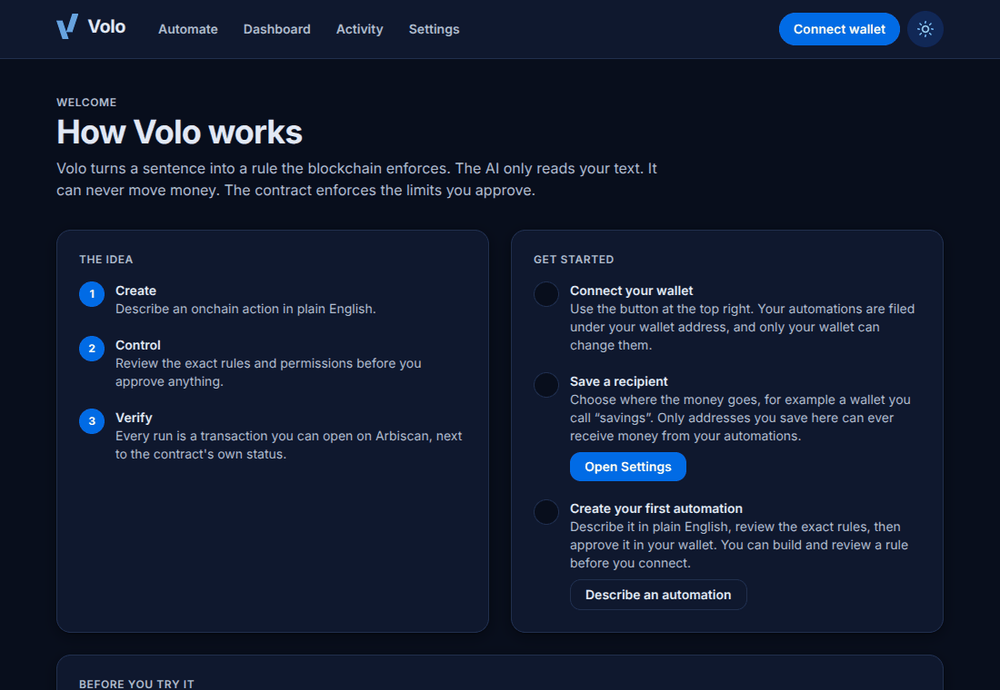

# Volo

**Tell it what you want in plain English. A smart contract makes sure it only ever does that.**

Volo is an intent layer for onchain automation on Arbitrum. You describe an action, such as *"Every Friday, send $10 to my savings wallet when my balance is above $100."* Volo turns that sentence into a small, fixed rule, shows you exactly what it understood, and only after you approve it in your wallet does a smart contract hold the permission. A worker then runs it on schedule, inside limits the contract enforces on every single run.

> **Unaudited testnet prototype.** Arbitrum Sepolia, test tokens only. Do not use funds you cannot afford to lose.

**Live demo:** https://volo-onarb.onrender.com (needs a wallet on Arbitrum Sepolia with a little test ETH and test USDC)

<p align="center">
  
</p>

<p align="center">
  
  &nbsp;&nbsp;
  
</p>

## Why it is safe to let an AI near money

The AI never has spending power. It only fills in a form, and three layers each distrust the one before:

1. **The AI reader** turns your sentence into JSON. Its answer is treated as untrusted. It never sees wallets, keys or addresses.
2. **The app checks that answer against your own words.** The amount, the balance condition, the weekday and the recipient must really be in what you wrote, and the amount and balance must not be swapped. Anything else is refused. A recipient is only ever a *name* ("savings"); the address behind it is one you saved yourself.
3. **The contract enforces the limits on every run,** no matter who calls it: the locked recipient, a cap per run and per week, an expiry date, the weekday, once per day, and your balance condition. A buggy or compromised worker cannot send to a new address or exceed your caps.

## What you can do

- **Chat to build a rule.** Numbers are understood however you write them (`$1k`, "ten", "a hundred"), and if something is missing Volo asks, then finishes the rule from your short answer.
- **Review before anything happens.** You see the exact amounts, caps, schedule, recipient and expiry first. Afterwards, each automation's page shows what the contract enforces, read live from the chain.
- **Your own recipients.** Each wallet saves its own named recipients in Settings, with a signature. Nobody else can add or change yours.
- **Manage from the Dashboard.** Pause, resume, cancel, renew or revoke the USDC approval, and see every run with a link to its transaction.
- **Many users.** Your wallet is your account. Every change is signed by the wallet that owns it.
- **Light and dark.** Follows your device, with a switch in the header.

## How it fits together

```
sentence ─► AI reader ─► checked rule ─► you review ─► wallet approves ─► contract holds permission
                                                                                  │
                                       worker wakes on schedule ─► contract.execute() re-checks every rule
```

[docs/ARCHITECTURE.md](docs/ARCHITECTURE.md) has the step-by-step flow, a map of every file, and every setting.

## Deployed contract (Arbitrum Sepolia, chain 421614)

| | |
|---|---|
| Volo contract | [`0xc41Ae97Be00287851B0777BCAAbb7Ef07924fF21`](https://sepolia.arbiscan.io/address/0xc41Ae97Be00287851B0777BCAAbb7Ef07924fF21) |
| Test USDC (Circle) | [`0x75faf114eafb1BDbe2F0316DF893fd58CE46AA4d`](https://sepolia.arbiscan.io/address/0x75faf114eafb1BDbe2F0316DF893fd58CE46AA4d) |

## Built with

Solidity 0.8.24, OpenZeppelin 5 and Foundry for the contract · TypeScript, Next.js 14, Tailwind, wagmi and viem for the app · Groq (`openai/gpt-oss-120b`) for the AI reader, with an offline fallback · Supabase (Postgres) for storage · Docker on Render for hosting.

## Run it yourself

Needs Node 22. Copy `.env.example` to `.env` and fill it in (every setting is explained in [docs/ARCHITECTURE.md](docs/ARCHITECTURE.md)).

```bash
cd backend  && npm install
cd frontend && npm install
cd frontend && npm run build && npm run start    # the website, http://localhost:3000
cd backend  && npm run worker                    # the scheduler (a second terminal)
cd backend  && npm run check                     # checks your settings without sending anything
```

Always start the website with `npm run build` and `npm run start`; they load the root `.env`. A plain `next start` does not.

Without a Groq key, Volo uses a basic offline reader that is fine for the examples but can misread wording like "below". Add `GROQ_API_KEY` for the real thing.

## Host it

The `Dockerfile` runs the website and the worker in one container (`scripts/start-hosted.sh`), so it works on any Docker host. On a host with no persistent disk, such as a free Render web service, use Supabase for storage: create a project, run `supabase/schema.sql` in its SQL editor, and set `SUPABASE_URL` and `SUPABASE_SECRET_KEY`. `GET /api/health` reports whether storage, the executor wallet and the AI reader are healthy.

## Tests

```bash
cd contracts && forge test           # the contract (91 Foundry tests)
cd backend  && npm test              # all app logic: parser, grounding checks, storage, auth, scheduler
bash scripts/sync-shared.sh --check  # shared files are in sync
cd frontend && npm run build         # types, lint, pages
```

## Known limits

- The contract is unaudited, and Volo runs on a test network only.
- One shared executor wallet sends every user's runs and pays their gas, and one worker process schedules them. If the worker is down, runs do not happen. Production would use a decentralised keeper network.
- Anyone who knows a wallet address can read its saved recipients. Wallet sign-in sessions are needed before real money.
- Approvals are used up by each run, so a weekly rule needs its USDC approval renewed.
- Schedules are in UTC, because the contract has no time zones.

## Roadmap

Gasless smart accounts with ZeroDev (built on a branch, not yet tested against the real service) · rules triggered by market prices using Chainlink data feeds (the contract supports it, the app does not yet) · an event index with The Graph · wallet login with Privy · a keeper network in place of the single worker · an audit, then mainnet.
